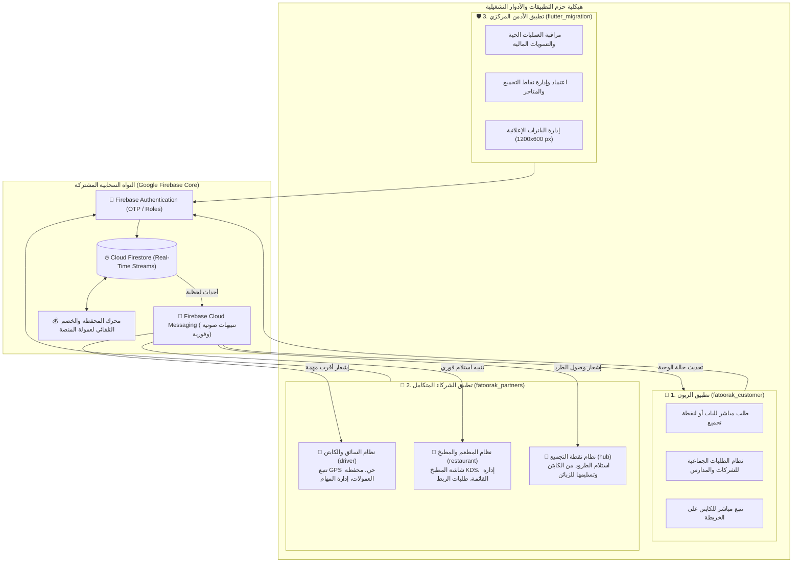

# 🍳 منظومة فطورك (Fatoorak): البنية الهندسية لمنصة الإفطار والخدمات اللوجستية الذكية
### التوثيق الفني الشامل لمعمارية التطبيقات المترابطة (Ecosystem Architecture)

🌐 **اللغة / Language**: [English](README_EN.md) | **العربية**

[](https://flutter.dev)
[](https://dart.dev)
[](https://firebase.google.com)
[-FFA611?logo=firebase&logoColor=white)](https://firebase.google.com/docs/firestore)
[](https://firebase.google.com/docs/cloud-messaging)
[](https://firebase.google.com/docs/firestore/security/get-started)
[](#-حقوق-الملكية-والخصوصية)

---

## 📌 نبذة عامة وفلسفة النظام (System Mission & Architecture)

منظومة **فطورك (Fatoorak)** هي شبكة لوجستية رقمية متكاملة لرقمنة قطاع الإفطار الصباحي ودعم المطاعم الشعبية والأسر المنتجة. يعتمد النموذج التشغيلي للمنظومة على كسر حواجز المسافات الجغرافية التقليدية وتوحيد كفاءة التوصيل من خلال ابتكار نظام **"نقاط التجميع (Collection Points)"** و**"طلبات الربط"** لخدمة تجمعات الموظفين في المدارس والشركات والمؤسسات.

تتكون المنظومة برمجياً من **ثلاث حزم تطبيقات رئيسية (تغطي 5 أدوار تشغيلية متكاملة)** مرتبطة بنواة سحابية موحدة عبر تقنية **Real-Time Snapshot Streams** على Google Firebase دون واجهات ويب للطلب:

1. **📱 تطبيق الزبون (`fatoorak_customer`)**: لتصفح المطاعم، الطلب المباشر أو لنقاط التجميع، والطلبات الجماعية للمدارس والشركات.
2. **🛡️ تطبيق الأدمن والإشراف العام (`flutter_migration`)**: للمراقبة الحية لجميع الطلبات في الإقليم، إدارة المتاجر والسائقين، الحسابات والعمولات، وإعلانات البانرات.
3. **🤝 تطبيق الشركاء المتكامل (`fatoorak_partners`)**: ويشمل ثلاثة أنظمة تشغيلية فرعية في تطبيق واحد:
   - 🛵 **نظام السائق والكابتن (`driver`)**: تتبع GPS، محفظة العمولات، وإدارة المهام.
   - 🍳 **نظام المطعم والمطبخ (`restaurant`)**: شاشة المطبخ KDS، القائمة، وطلبات الربط.
   - 🏢 **نظام نقطة التجميع للمؤسسات والمدارس (`hub`)**: استلام الطرود من الكابتن وتسليمها للزبائن.

> 🔒 **ملاحظة الخصوصية وحماية الأصول البرمجية**:
> حرصاً على سرية نموذج العمل التجاري، وشروط الشراكة، وقواعد البيانات الخاصة، تم تخصيص هذا المستودع لاستعراض **المعمارية الهندسية، تدفق البيانات اللوجستية، والدورات المالية والتقنية** دون كشف الكود المصدري التنفيذي أو المفاتيح البرمجية الحساسة.

---

## 🏛️ المخطط المعماري الشامل وتدفق العمليات (End-to-End System Architecture)



---

## 🧩 التفصيل الفني والشاشات لكل تطبيق داخل المشروع

### 1. 📱 تطبيق الزبون (Customer App)
* **المسار البرمجي داخل المشروع**:
  `Antigravity/fatoorak-breakfast-delivery/fatoorak_customer`
* **الشاشات والمكونات الرئيسية (`lib/customer/screens`)**:
  - **`home_screen.dart`**: استعراض المطاعم والمطابخ الشعبية القريبة، العروض الحصرية، وبانرات الإفطار الصباحي.
  - **`customer_map_picker_screen.dart`**: تحديد الموقع التفاعلي عبر الخريطة واختيار التوصيل للمنزل أو استلام الوجبة من نقطة تجميع معتمدة.
  - **`shop_menu_screen.dart`**: استعراض قائمة وجبات المطعم، تخصيص الإضافات، والأحجام.
  - **`cart_screen.dart` & `checkout_screen.dart`**: سلة المشتريات وإتمام الطلب واختيار الدفع كاش عند الاستلام.
  - **`order_tracking_screen.dart`**: تتبع مسار الكابتن الحي على الخريطة ومتابعة مراحل إعداد وتوصيل الوجبة لحظياً.
  - **`shared_orders_screen.dart`**: ميزة **"التوصيل على الكل"** والطلبات المجمعة للموظفين والمدارس في طلب واحد لتقليل رسوم التوصيل.
  - **`vouchers_screen.dart`**: إدارة قسائم ورموز الخصم.
  - **`orders_screen.dart` & `order_details_screen.dart`**: أرشيف الطلبات السابقة وتفاصيل الفواتير.

---

### 2. 🛡️ تطبيق الأدمن والإشراف العام (Admin App)
* **المسار البرمجي داخل المشروع**:
  `Antigravity/fatoorak-breakfast-delivery/flutter_migration` (داخل مجلد `lib/admin`)
* **الشاشات والمكونات الرئيسية (`lib/admin/screens`)**:
  - **`admin_monitoring_screen.dart`**: شاشة المراقبة الميدانية اللحظية لمتابعة كافة الطلبات النشطة على مستوى الإقليم والتدخل عند أي تأخير.
  - **`admin_collection_points_screen.dart` & `add_collection_point_screen.dart`**: إدارة واعتماد نقاط التجميع الجديدة في المدارس والمؤسسات وضبط إحداثياتها.
  - **`admin_shops_screen.dart`**: إدارة ملفات المطاعم والمطابخ ومراقبة الأسعار وجودة الخدمة وتفعيل الحسابات.
  - **`admin_drivers_screen.dart`**: إدارة السائقين ومراقبة جاهزيتهم وسجلات نشاطهم.
  - **`admin_finance_screen.dart`**: الإدارة المالية المركزية، تسوية العمولات، ومتابعة أرصدة محافظ الكباتن والتقارير المحاسبية.
  - **`admin_ads_screen.dart`**: إدارة البانرات الإعلانية داخل التطبيقات وفق المعيار الهندسي الدقيق **1200×600 px** بنسبة **2:1**.
  - **`admin_system_controls_screen.dart`**: مفاتيح التحكم بالنظام وتفعيل وضع الصيانة السحابي (Maintenance Mode).
  - **`admin_requests_screen.dart`**: مراجعة طلبات الانضمام وتعديل البيانات الواردة من المطاعم والكباتن.

---

### 3. 🤝 تطبيق الشركاء المتكامل (Partners App - Multi-Role Platform)
* **المسار البرمجي داخل المشروع**:
  `Antigravity/fatoorak-breakfast-delivery/fatoorak_partners`
* **وصف المعمارية**: تطبيق موحد يحتوي على ثلاثة أنظمة تشغيلية مستقلة يتم الدخول إليها وتفعيلها بحسب دور الشريك المسجل:

#### أ. 🛵 نظام السائق والكابتن (`lib/driver`)
* **الشاشات والمكونات (`lib/driver/screens`)**:
  - **`active_route_screen.dart`**: شاشة الملاحة والمسار الحي لتوجيه الكابتن إلى المطعم ثم إلى العميل أو نقطة التجميع.
  - **`available_orders_tab.dart`**: استعراض الطلبات المتاحة في النطاق الجغرافي وقبول المهام المناسبة.
  - **`financials_tab.dart`**: محفظة الكابتن الرقمية مسبقة الشحن، عرض العمولات المقتطعة آلياً، وسجل الأرباح اليومية.
  - **`my_jobs_tab.dart` & `history_tab.dart`**: متابعة المهام قيد التوصيل والاطلاع على سجل الرحلات المكتملة.
  - **تتبع الـ GPS في الخلفية**: تفعيل التتبع الجغرافي أثناء وضع النشاط فقط لربط الكابتن بالطلبات وتزويد العميل بالمسار الحي.

#### ب. 🍳 نظام المطعم والمطبخ (`lib/restaurant`)
* **الشاشات والمكونات (`lib/restaurant/screens`)**:
  - **`kitchen_screen.dart`**: شاشة المطبخ الرقمية (KDS) المصممة للعمل على الأجهزة اللوحية مع تنبيهات صوتية مستمرة لا تتوقف إلا بقبول الطلب والبدء بالتحضير.
  - **`menu_screen.dart`**: إدارة قائمة الطعام، إضافة الوجبات، وتفعيل/تعطيل توفر الأصناف بنقرة واحدة لتفادي طلب سلع نفذت.
  - **`linked_hubs_screen.dart` & `hub_requests_screen.dart`**: ميزة **"طلبات الربط"** لإرسال وقبول طلبات الارتباط مع نقاط التجميع البعيدة (مدارس، شركات) لتوسيع نطاق المبيعات.
  - **`direct_orders_screen.dart` & `scheduled_orders_screen.dart`**: متابعة الطلبات الفورية المباشرة والطلبات المجدولة مسبقاً.

#### ج. 🏢 نظام نقطة التجميع للمؤسسات (`lib/hub`)
* **الشاشات والمكونات (`lib/hub/screens`)**:
  - **`collection_point_dashboard_screen.dart`**: واجهة مسؤولي المدارس والشركات لإدارة استلام الطرود من الكباتن ومطابقتها برقم الطلب وتسليمها للزبائن.
  - **`link_restaurant_screen.dart`**: إرسال طلبات ارتباط لمطابخ ومطاعم معينة لتوفير وجباتها داخل المؤسسة.
  - **`linked_restaurants_screen.dart`**: إدارة المطاعم الشريكة المرتبطة بالنقطة ومتابعة قوائم وجباتها المعتمدة.
  - **إدارة دورة الكاش المسترد**: دفع ثمن الطلب للكابتن نقداً كـ "أمانة مستردة" فور الاستلام، وتحصيل المبلغ من العميل عند حضوره لاستلام وجبته.

---

## 🔄 مسار الطلب والتدفق المالي (End-to-End Order & Cash Flow)

```plaintext
[1. الزبون ينشئ الطلب من fatoorak_customer ويختار نقطة التجميع أو التوصيل المباشر]
                                 │
                                 ▼ (تنبيه صوتي فوري عبر FCM)
[2. المطعم يستقبل الطلب في kitchen_screen عبر fatoorak_partners ويبدأ التحضير]
                                 │
                                 ▼ (إشعار السائق الأقرب عبر available_orders_tab)
[3. الكابتن يصل للمطعم، يدفع ثمن الوجبات نقداً ويستلم الطلب]
                                 │
                 ┌───────────────┴───────────────┐
                 ▼                               ▼
    [مسار أ: توصيل مباشر للباب]      [مسار ب: تسليم لنقطة التجميع (hub)]
                 │                               │
                 │                               ├─ الكابتن يسلم الطرد ويستلم الكاش من مسؤول النقطة
                 │                               ├─ مسؤول النقطة يحدث الحالة في collection_point_dashboard
                 │                               └─ الزبون يحضر للنقطة، يدفع الكاش ويستلم وجبته
                 │
                 ▼
[4. اكتمال العملية ──► النظام يخصم عمولة المنصة آلياً من محفظة الكابتن المشحونة]
```

---

## 📂 الهيكلة الحقيقية لمجلدات كود المنظومة (Source Code Directory Tree)

```plaintext
Fatoorak/
└── Antigravity/fatoorak-breakfast-delivery/
    │
    ├── 📱 fatoorak_customer/             # تطبيق الزبون (Flutter)
    │   └── lib/customer/
    │       ├── screens/                  # (home, menu, cart, checkout, map_picker, tracking, shared)
    │       ├── providers/                # State management (Cart, Auth, Location)
    │       └── services/                 # Firebase listeners & Order services
    │
    ├── 🛡️ flutter_migration/             # تطبيق الأدمن المركزي (Flutter)
    │   └── lib/admin/
    │       ├── screens/                  # (monitoring, collection_points, shops, drivers, finance, ads)
    │       └── services/                 # Admin APIs, Audit logs & Cloud controls
    │
    └── 🤝 fatoorak_partners/             # تطبيق الشركاء المتكامل (Flutter - 3 في 1)
        └── lib/
            ├── driver/                   # 🛵 نظام السائق والكابتن
            │   └── screens/              # (active_route, available_orders, financials, my_jobs)
            ├── restaurant/               # 🍳 نظام المطعم وشاشة المطبخ (KDS)
            │   └── screens/              # (kitchen_kds, menu, linked_hubs, direct_orders)
            └── hub/                      # 🏢 نظام نقطة التجميع للمدارس والشركات
                └── screens/              # (collection_point_dashboard, link_restaurants)
```

---

## 🔒 حقوق الملكية والخصوصية
* جميع حقوق الفكرة، المعمارية الهندسية، والعلامة التجارية محفوظة لمنصة **فطورك (Fatoorak)** © 2026.
* هذا المستودع مخصص لأغراض استعراض المعمارية الهندسية وتصميم النظم اللوجستية المتكاملة (Multi-Role Logistics System Architecture Showcase).
