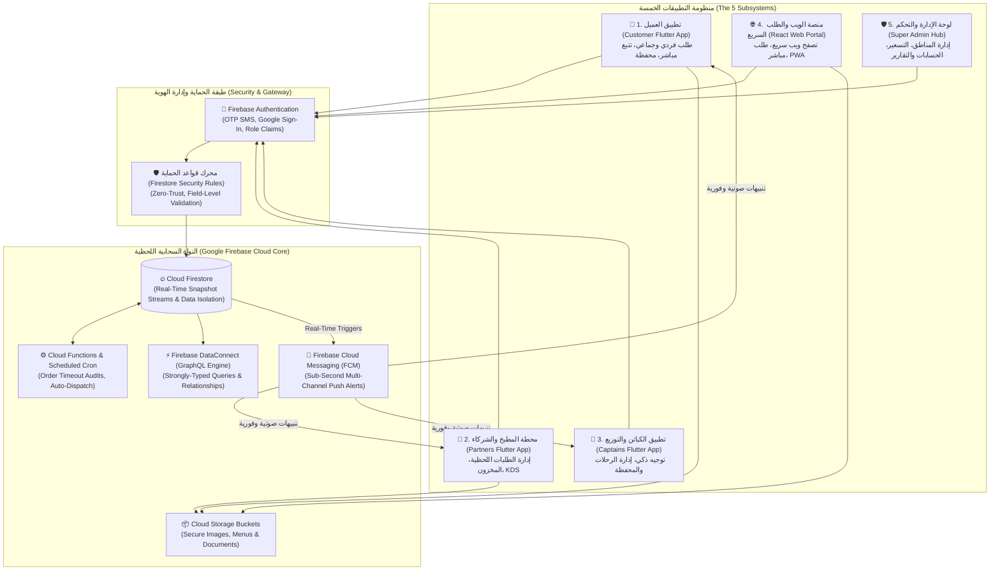

# 🍳 Fatoorak (فطورك): 5-Application Food Logistics & Multi-Tenant Breakfast Ecosystem
### Enterprise System Architecture, Multi-Client Cloud Infrastructure & Engineering Design

[](https://flutter.dev)
[](https://dart.dev)
[](https://react.dev)
[](https://www.typescriptlang.org)
[](https://tailwindcss.com)
[](https://firebase.google.com)
[-FFA611?logo=firebase&logoColor=white)](https://firebase.google.com/docs/firestore)
[](https://firebase.google.com/docs/firestore/security/get-started)
[](#-حقوق-الملكية-والخصوصية)

---

## 📌 نبذة عامة عن النظام (Executive Overview)

منظومة **فطورك (Fatoorak)** هي منصة سحابية لوجستية متكاملة متعددة الأطراف (Multi-Tenant On-Demand Food Ecosystem)، متخصصة في إدارة وتوصيل وجبات الإفطار الصباحية الطازجة. تجمع المنصة بين المطاعم الشعبية التقليدية والأسر المنتجة من جهة، والعملاء الأفراد وتجمعات الموظفين في الشركات والمدارس من جهة أخرى، بدعم من أسطول لوجستي محلي ذكي.

تم تصميم وهندسة المنظومة لتعمل كشبكة متزامنة في الوقت الفعلي تتكون من **خمسة تطبيقات وأنظمة فرعية (5 Integrated Subsystems)** مرتبطة بنواة سحابية موحدة فائقة السرعة على **Google Firebase**.

> 🔒 **بيان حماية الخصوصية والملكية الفكرية**:
> نظراً لكون المنصة مشروعاً تجارياً حياً يحتوي على أسرار عمل وخوارزميات لوجستية محمية، تم تخصيص هذا المستودع لاستعراض **المعمارية الهندسية، مخططات تدفق البيانات، وتصميم البنية التحتية** دون كشف الكود المصدري التنفيذي أو المفاتيح الحساسة.

---

## 🏛️ خريطة المعمارية المتكاملة للأنظمة الخمسة (Ecosystem Architecture)

يوضح المخطط أدناه كيفية ترابط التطبيقات الخمسة وتزامنها اللحظي مع النواة السحابية:



---

## 🧩 التفصيل التقني للأنظمة الخمسة (The 5 Subsystems Breakdown)

### 1. 📱 تطبيق العميل (Customer Mobile App)
* **التقنية**: Flutter 3.x, Dart, Provider / Riverpod.
* **الوظائف الهندسية**:
  - تصفح ديناميكي للمطابخ الشعبية والأسر المنتجة مصنفة حسب القرب الجغرافي.
  - **نظام الطلب الجماعي للشركات (Corporate & Group Orders)**: ميزة هندسية تتيح لمجموعة موظفين إضافة وجباتهم في سلة موحدة مع تقسيم الفاتورة وتنسيق موعد توصيل جماعي دقيق.
  - **التتبع الجغرافي اللحظي**: عرض موقع الكابتن وحالة تجهيز الطعام لحظة بلحظة عبر مستمعي `Firestore Streams` مع تقليل استهلاك البطارية.
  - محفظة رقمية مدمجة وخيارات دفع مرنة (نقدي، دفع إلكتروني، رصيد محفظة).

### 2. 🍳 تطبيق الشركاء والمطابخ (Partners & Kitchens Terminal App)
* **التقنية**: Flutter (مهيأ للأجهزة اللوحية والهواتف الذكية).
* **الوظائف الهندسية**:
  - **شاشة عرض المطبخ الرقمية (Kitchen Display System - KDS)**: واجهة استقبال طلبات فورية ذات تنبيهات صوتية قوية لا تتوقف إلا بتأكيد الاستلام.
  - إدارة مرنة لقائمة الطعام (Menu Management): تشغيل وإيقاف توفر الوجبات بنقرة واحدة لتفادي طلب وجبات نفذت من المخزون.
  - تحليلات وتقارير مالية يومية وأسبوعية لمراقبة الأرباح ومستحقات السحب.

### 3. 🛵 تطبيق الكباتن والتوزيع اللوجستي (Captains & Dispatch App)
* **التقنية**: Flutter, Google Maps SDK, Background Location Services.
* **الوظائف الهندسية**:
  - خوارزمية ذكية لاستلام وتعيين الطلبات بناءً على موقع الكابتن والمسافة إلى المطعم والعميل.
  - تحديث إحداثيات السائق الحية في السحابة مع معالجة حالات انقطاع الشبكة المؤقتة.
  - إدارة المحفظة المالية للكابتن: احتساب عمولة التوصيل آلياً لكل رحلة وعرض ملخص الدخل اليومي.

### 4. 🌐 منصة الويب والطلب السريع (Web Ordering & Marketing Portal)
* **التقنية**: React 18, TypeScript, Tailwind CSS, Vite.
* **الوظائف الهندسية**:
  - واجهة ويب عصرية فائقة السرعة تتيح للعملاء الطلب من المتصفح مباشرة دون اشتراط تحميل التطبيق.
  - توليد بطاقات المعاينة الاجتماعية (Dynamic Open Graph Metadata) لروابط الوجبات والمطاعم لزيادة معدلات المشاركة.
  - جاهزية العمل كتطبيق ويب تقدمي (Progressive Web App - PWA).

### 5. 🛡️ لوحة الإدارة والتحكم السحابية (Super Admin Hub & Cloud Dispatch)
* **التقنية**: React / Node.js + Firebase Admin SDK.
* **الوظائف الهندسية**:
  - إدارة الحدود الجغرافية للمدن ومناطق التوصيل (Geofencing & Delivery Zones).
  - ضبط العمولات، رسوم التوصيل، وحسابات التسوية للمطاعم والكباتن.
  - مراقبة حية لجميع الطلبات النشطة على الخريطة للتدخل السريع عند أي تأخير لوجستي.

---

## ⚡ دورة حياة الطلب المتزامنة (Real-Time Order State Machine)

تتحرك بيانات الطلب عبر مسار تدفق صارم يمنع حدوث أي تعارض (Race Conditions) أو تكرار:

```plaintext
[عميل: إنشاء طلب] ──► (PENDING) ──► [تنبيه صوتي للمطبخ عبر FCM]
                                             │
                                             ▼
[مطبخ: بدء التجهيز] ◄── (ACCEPTED) ◄── [مطبخ: قبول الطلب]
        │
        ▼
   (PREPARING) ──► [تجهيز الوجبة] ──► (READY_FOR_PICKUP)
                                              │
                                              ▼
[كابتن: استلام وتوصيل] ◄── (DISPATCHED) ◄── [تعيين أقرب كابتن]
        │
        ▼
   (ON_THE_WAY) ──► [تتبع حي على خريطة العميل]
        │
        ▼
   (DELIVERED) ──► [تحديث المحافظ المالية آلياً وإغلاق الطلب]
```

---

## 🛠️ جدول التقنيات والأدوار الهندسية (Tech Stack Breakdown)

| الطبقة (Layer) | التقنيات المستخدمة | الدور الهندسي في منظومة فطورك |
| :--- | :--- | :--- |
| **تطبيقات الموبايل** | Flutter 3.x, Dart, Provider | بناء كود موحد لتطبيقات العميل، الشريك، والكابتن بأداء أصلي (60 FPS) واستجابة لحظية لأحداث الـ Firestore Streams. |
| **واجهة الويب** | React 18, TypeScript, Tailwind | منصة طلب ويب سريعة مدعومة بنظام تدقيق الأنواع لمنع أخطاء البيانات وتوفير تجربة مستخدم سلسة. |
| **قاعدة البيانات اللحظية** | Cloud Firestore | تخزين البيانات بدون خادم (Serverless) مع تفعيل ميزة الاستماع اللحظي (Snapshot Listeners) لتحديث واجهات المطابخ فوراً. |
| **طبقة الاستعلام المتقدمة** | Firebase DataConnect (GraphQL) | استعلامات مترابطة وقوية لتقارير المبيعات والعلاقات المعقدة بين المطابخ والطلبات. |
| **الخوادم اللاخادومية (Serverless)** | Firebase Cloud Functions (Node.js) | تنفيذ العمليات الحساسة (حساب أرباح الكباتن، أرشفة الطلبات، الفحص الدوري للأمان). |
| **شبكة الإشعارات** | Firebase Cloud Messaging (FCM) | إرسال إشعارات فورية موثوقة لأجهزة الموبايل (حتى في وضع السكون والخلفية). |
| **الأمان والحوكمة** | Firestore Security Rules | التحقق الصارم من صحة الحقول، منع تلاعب الأسعار، وحصر الصلاحيات حسب الدور (Role-Based Access Control). |

---

## 🔐 سياسات الحماية وقواعد الأمان (Security & Cloud Governance)

لحماية العمليات المالية والبيانات التشغيلية، يطبق النظام سياسة أمان صارمة:

1. **حظر التلاعب بالأسعار ورسوم التوصيل**:
   - لا يستطيع العميل إرسال أسعار الوجبات أو رسوم التوصيل من الواجهة الأمامية؛ يتم سحب الأسعار واعتمادها مباشرة من سجلات المطاعم الموثقة في السحابة.
2. **عزل بيانات الشركاء (Multi-Tenant Isolation)**:
   - كل شريك (مطعم أو أسرة منتجة) يستطيع فقط قراءة وتعديل الطلبات وقوائم الطعام الخاصة بمطعمه عبر قواعد أمان مبنية على معرف المستخدم (`request.auth.uid`).
3. **منع تعديل حالات الطلب غير المصرح بها**:
   - لا يمكن للعميل تحويل حالة الطلب إلى "تم التوصيل"، ولا يمكن للكابتن قبول طلب تم تخصيصه لكابتن آخر.
4. **أمان الويب وتعطيل خرائط المصدر**:
   - نشر الواجهات بملفات مجمعة ومضغوطة مع إغلاق خرائط المصدر (`sourcemap: false`) لمنع الوصول للكود المصدري الأصلي.

---

## 📂 الهيكلة الهندسية الشاملة للمنظومة (Architecture Folder Tree)

```plaintext
fatoorak-ecosystem/
├── apps/
│   ├── fatoorak_customer/           # 📱 تطبيق العميل (Flutter / Mobile)
│   │   ├── lib/features/            # (auth, catalog, cart, orders, live_tracking)
│   │   └── lib/core/                # State management, Network & Theme
│   ├── fatoorak_partners/           # 🍳 تطبيق المطابخ والشركاء (KDS Terminal)
│   │   ├── lib/features/            # (kitchen_display, menu_editor, financials)
│   │   └── lib/core/                # Audio alerts & Realtime order streams
│   ├── fatoorak_captains/           # 🛵 تطبيق المناديب والتوصيل (Logistics)
│   │   ├── lib/features/            # (dispatch, navigation, wallet, geofence)
│   │   └── lib/core/                # Background location tracking service
│   ├── fatoorak_web/                # 🌐 بوابة الويب والطلب السريع (React / Vite)
│   │   ├── src/components/          # Reusable responsive UI components
│   │   └── src/services/            # Firebase SDK integration & API layer
│   └── fatoorak_admin/              # 🛡️ لوحة التحكم والإشراف العام (Admin Portal)
│
├── cloud_backend/
│   ├── functions/                   # ⚙️ Firebase Cloud Functions (Node.js)
│   │   ├── src/orders/              # Order lifecycle transitions & timeout audits
│   │   └── src/finance/             # Automated commission & payout calculations
│   ├── dataconnect/                 # ⚡ GraphQL Schemas & Connector queries
│   ├── firestore.rules              # 🛡️ سياسات الأمان والحوكمة لقاعدة البيانات
│   └── storage.rules                # 📦 سياسات حماية الوسائط والصور المرفوعة
│
└── .gitignore                       # حظر شامل للمفاتيح والبيئات السرية
```

---

## 🔒 حقوق الملكية والخصوصية
* جميع حقوق التصميم، الهيكلة المعمارية، والعلامة التجارية محفوظة لمنصة **فطورك (Fatoorak)** © 2026.
* هذا المستودع مخصص لأغراض استعراض المعمارية الهندسية الشاملة وتصميم النظم متعددة الأطراف (Multi-Tenant System Architecture Showcase).
