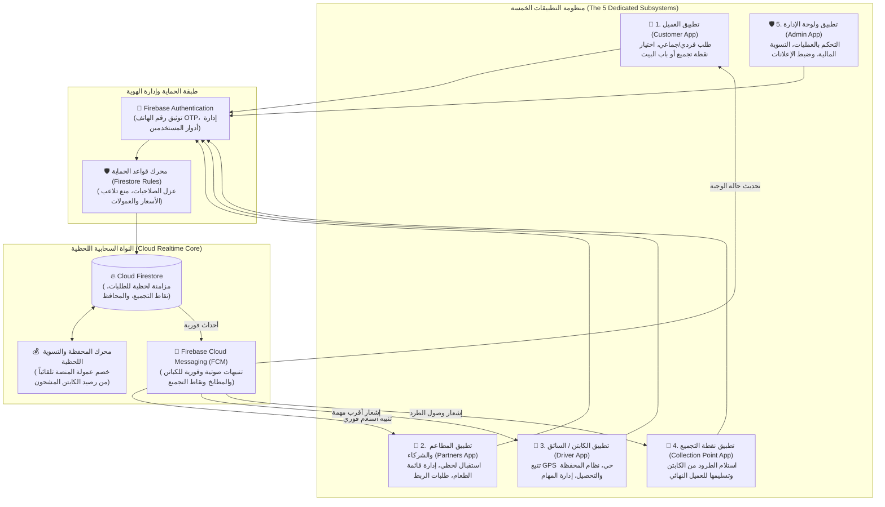

# 🍳 منظومة فطورك (Fatoorak): البنية الهندسية لمنصة الإفطار والخدمات اللوجستية الذكية
### التوثيق الفني الشامل لمعمارية التطبيقات الخمسة المترابطة (5-Application Ecosystem Architecture)

[](https://flutter.dev)
[](https://dart.dev)
[](https://firebase.google.com)
[-FFA611?logo=firebase&logoColor=white)](https://firebase.google.com/docs/firestore)
[](https://firebase.google.com/docs/cloud-messaging)
[](https://firebase.google.com/docs/firestore/security/get-started)
[](#-حقوق-الملكية-والخصوصية)

---

## 📌 نبذة عامة وفلسفة النظام (System Mission & Architecture)

منظومة **فطورك (Fatoorak)** هي شبكة لوجستية رقمية متكاملة لرقمنة قطاع الإفطار الصباحي ودعم المطاعم الشعبية والأسر المنتجة. يعتمد النموذج التشغيلي للمنظومة على كسر حواجز المسافات الجغرافية التقليدية وتوحيد كفاءة التوصيل من خلال ابتكار نظام **"نقاط التجميع (Collection Points)"** و**"طلبات الربط"** لخدمة تجمعات الموظفين في المدارس والشركات والمؤسسات.

تتكون المنظومة من **خمسة أطراف وتطبيقات رئيسية مترابطة لحظياً** دون واجهات ويب للطلب؛ حيث تتم كافة العمليات التشغيلية واللوجستية عبر تطبيقات مخصصة مرتبطة بقاعدة بيانات موحدة وفائقة السرعة عبر تقنية **Real-Time Snapshot Streams**.

> 🔒 **ملاحظة الخصوصية وحماية الأصول البرمجية**:
> حرصاً على سرية نموذج العمل التجاري، وشروط الشراكة، وقواعد البيانات الخاصة، تم تخصيص هذا المستودع لاستعراض **المعمارية الهندسية، تدفق البيانات اللوجستية، والدورات المالية والتقنية للتطبيقات الخمسة** دون كشف الكود المصدري التنفيذي أو المفاتيح البرمجية الحساسة.

---

## 🏛️ المخطط المعماري الشامل وتدفق العمليات (End-to-End System Architecture)

يوضح المخطط أدناه الترابط الدائري بين أطراف المنظومة الخمسة والنواة السحابية المشتركة:



---

## 🧩 التفصيل الفني والتشغيلي للتطبيقات الخمسة (Detailed Subsystems Breakdown)

### 1. 📱 تطبيق العميل (Customer App)
* **المستخدم المستهدف**: الزبائن الأفراد، تجمعات الموظفين والمعلمين، والطلاب.
* **الخصائص والوظائف التقنية**:
  - **خيارات التوصيل المتعددة**: يتيح للعميل اختيار استلام الطلب عند باب البيت، أو الاستلام من **"نقطة تجميع معتمدة"** (مدرسة، شركة، مجمع سكني).
  - **ميزة "التوصيل على الكل"**: تجميع طلبات تجمعات الموظفين في طلب واحد لتقليل رسوم التوصيل وتسريع وصول الإفطار ساخناً في موعد موحد.
  - **اكسر حدود المسافات**: إمكانية الطلب من مطابخ ومطاعم بعيدة خارج التغطية التقليدية بفضل ربطها المسبق بنقطة التجميع المعتمدة لمؤسسة العميل.
  - **تتبع المسار الحي (Live GPS Tracking)**: متابعة خط سير الكابتن لحظة بلحظة حتى وصوله.
  - **الدفع عند الاستلام**: محاسبة الكابتن نقداً عند الباب أو محاسبة مسؤول نقطة التجميع.

---

### 2. 🍳 تطبيق الشركاء والمطاعم (Partners & Kitchens App)
* **المستخدم المستهدف**: المطاعم الشعبية، المطابخ الإنتاجية، والأسر المنتجة.
* **الخصائص والوظائف التقنية**:
  - **تحويل المطعم إلى "مطعم ذكي"**: استقبال الطلبات لحظياً مع إشعارات صوتية ومرئية تنبه المطبخ بضرورة بدء التجهيز فوراً.
  - **ميزة "طلبات الربط"**: تمكين المطعم من الارتباط بنقاط تجميع بعيدة جغرافياً (مثل مدرسة كبرى في منطقة أخرى) لفتح أسواق ومبيعات جديدة كلياً.
  - **إدارة حية لقائمة الطعام والتوفر**: تفعيل وتعطيل الوجبات فور نفادها لمنع طلب وجبات غير متوفرة وضمان التزام المطعم بالأسعار المعتمدة.
  - **الدورة المحاسبية**: تتبع قيمة الوجبات المباعة ومستحقات المطعم بعد اقتطاع عمولة التشغيل التقنية.

---

### 3. 🛵 تطبيق الكابتن / السائق (Driver & Logistics App)
* **المستخدم المستهدف**: الكباتن ومندوبو التوصيل (شركاء لوجستيون مستقلون).
* **الخصائص والوظائف التقنية**:
  - **تتبع الموقع الجغرافي بالخلفية (Background GPS Service)**: يعمل أثناء فترة النشاط فقط لتوجيه أقرب الطلبات للكابتن وتزويد العميل ونقاط التجميع بالمسار الحي.
  - **نظام المحفظة الإلكترونية مسبقة الشحن**: يشترط النظام احتفاظ الكابتن بحد أدنى من الرصيد في محفظته؛ وعند تسليم الطلب وتحصيل الكاش، يُخصم نصيب المنصة التقني آلياً من رصيد المحفظة دون مديونيات مؤجلة.
  - **الدورة المالية المزدوجة للكابتن**:
    1. يدفع الكابتن للمطعم قيمة الوجبات نقداً عند الاستلام (استثمار مؤقت موثق).
    2. يسترد الكابتن كامل المبلغ (ثمن الوجبات + رسوم التوصيل) نقداً وفوراً من الزبون أو من مسؤول "نقطة التجميع" عند التسليم.
  - واجهة ملاحة وتوجيه توضح أسرع المسارات لتسليم الوجبات ساخنة.

---

### 4. 🏢 تطبيق نقطة التجميع (Collection Point App)
* **المستخدم المستهدف**: المدارس، الشركات، المؤسسات، ومراكز الاستلام التجارية المعتمدة.
* **الخصائص والوظائف التقنية**:
  - **تحويل المؤسسة إلى مركز إمداد ذكي**: واجهة سهلة لإدارة تدفق وجبات الإفطار الصباحية لمنتسبي المؤسسة بطريقة منظمة تمنع الفوضى عند المداخل.
  - **إدارة استلام وتسليم الطرود**: التحقق من أرقام الطرود المستلمة من الكابتن ومطابقتها، ثم تسليمها للعميل النهائي بعد التحقق من هويته عبر التطبيق.
  - **التسوية المالية اللحظية لنقطة التجميع**:
    1. عند وصول الكابتن، يدفع مسؤول النقطة إجمالي قيمة الطلب للكابتن نقداً (أمانة مستردة).
    2. عند حضور العميل المستفيد، تقوم النقطة بتحصيل المبلغ الموضح في التطبيق بالضبط.
    3. تحقيق عوائد إضافية وزيادة لحركة الزوار أو خدمة مجتمعية لمنسوبي المؤسسة.
  - **تحديث الحالة اللحظي**: تسجيل (تم الاستلام من الكابتن / تم التسليم للزبون) لتحديث قاعدة البيانات والنظام اللوجستي فوراً.

---

### 5. 🛡️ تطبيق ولوحة الإدارة المركزية (Super Admin App)
* **المستخدم المستهدف**: إدارة العمليات المركزية والدعم الفني لمنظومة فطورك.
* **الخصائص والوظائف التقنية**:
  - **المرجع النهائي لسجل العمليات**: تتبع شامل لكافة الحركات المالية واللوجستية لحل أي خلاف بين المطاعم، الكباتن، ونقاط التجميع بدقة مطلقة.
  - **إدارة وتوحيد إعلانات وبانرات التطبيق**: معايير برمجية صارمة لرفع الإعلانات بقياس دقيق **1200×600 px** ونسبة **2:1** (لتوافق مثالي مع كثافة شاشات الهواتف الحديثة $3\times$ Pixel Density).
  - **إدارة الحدود الجغرافية ونقاط الربط**: تفعيل واعتماد نقاط التجميع الجديدة وربطها بالمطابخ المرخصة.
  - **مراقبة التزام الأطراف**: تعليق الحسابات غير الملتزمة بمعايير النظافة، أو التي تتلاعب بالأسعار، أو الكباتن الذين يعطلون الموقع الجغرافي أثناء العمل.

---

## 🔄 مسار الطلب اللوجستي والمالي (Integrated Order & Cash Flow)

```plaintext
[1. العميل يطلب ويختار نقطة تجميع أو توصيل مباشر]
                       │
                       ▼ (تنبيه صوتي لحظي عبر FCM)
[2. المطعم يقبل الطلب ويبدأ التحضير]
                       │
                       ▼ (إشعار أقرب كابتن نشط يملك رصيد محفظة كافٍ)
[3. الكابتن يصل للمطعم ويدفع ثمن الوجبات "كاش" ويستلم الطلب]
                       │
         ┌─────────────┴─────────────┐
         ▼                           ▼
[خيار أ: توصيل مباشر للباب]    [خيار ب: تسليم لنقطة تجميع (مدرسة/شركة)]
         │                           │
         │                           ├─ الكابتن يسلم الطرد ويستلم الكاش من مسؤول النقطة
         │                           ├─ النقطة تحدث الحالة: "تم استلام الطرد بنجاح"
         │                           └─ العميل يحضر للنقطة، يدفع الكاش ويستلم وجبته
         │
         ▼
[4. تحصيل الكاش النهائي ──► النظام يخصم عمولة المنصة تلقائياً من محفظة الكابتن]
```

---

## 🛠️ جدول التقنيات والأدوار الهندسية (Technical Architecture Breakdown)

| التطبيق / الطبقة | التقنيات | الدور الهندسي الأساسي في منظومة فطورك |
| :--- | :--- | :--- |
| **تطبيق العميل** | `Flutter`, `Dart` | تجربة مستخدم سريعة، خرائط حية، اختيار نقاط التجميع، ودعم الطلبات المجمعة. |
| **تطبيق الشركاء (المطاعم)** | `Flutter (Tablet/Phone)` | شاشة مطبخ رقمية (KDS) بإشعارات صوتية لا تنقطع، إدارة القوائم، وطلبات الربط البعيدة. |
| **تطبيق الكابتن** | `Flutter`, `Background GPS` | تتبع الموقع الحي بالخلفية، المحفظة الرقمية، خصم العمولات، والتوجيه اللوجستي. |
| **تطبيق نقاط التجميع** | `Flutter` | واجهة فحص واستلام الطرود للمدارس والشركات، وتنسيق التسليم والتحصيل المالي. |
| **تطبيق الأدمن** | `Flutter / Dart` | إدارة المنظومة، سجل العمليات النهائي، التحكم بالإعلانات (1200×600)، وتوثيق الحسابات. |
| **قاعدة البيانات والتحكم** | `Cloud Firestore` | مزامنة لحظية فورية (Real-time Snapshot Listeners) خالية من التأخير الزمني. |
| **الإشعارات السحابية** | `Firebase Cloud Messaging` | بث تنبيهات لحظية وموثوقة لجميع التطبيقات عند تغير أي حالة طلب. |
| **محرك الأمان والحوكمة** | `Firestore Security Rules` | فرض صلاحيات وصول صارمة تمنع أي تلاعب بالأسعار أو العمولات أو بيانات العملاء. |

---

## 📂 الهيكلة الهندسية الشاملة لمشروع فطورك (5-App Folder Tree)

```plaintext
fatoorak-system/
├── apps/
│   ├── fatoorak_customer/          # 📱 تطبيق العميل (طلبات مباشرة، نقاط تجميع، وتتبع)
│   │   ├── lib/features/           # (catalog, group_orders, collection_points, tracking)
│   │   └── lib/core/               # State management, Theme & Network
│   │
│   ├── fatoorak_partners/          # 🍳 تطبيق المطابخ والشركاء (KDS، القوائم، طلبات الربط)
│   │   ├── lib/features/           # (live_orders, link_requests, menu_stock, earnings)
│   │   └── lib/core/               # Continuous sound engine & Realtime listeners
│   │
│   ├── fatoorak_captains/          # 🛵 تطبيق الكباتن والمناديب (تتبع GPS، محفظة العمولات)
│   │   ├── lib/features/           # (dispatch, background_location, cash_settlement)
│   │   └── lib/core/               # Wallet validator & Route navigation
│   │
│   ├── fatoorak_collection_points/ # 🏢 تطبيق نقاط التجميع (إدارة طرود المدارس والمؤسسات)
│   │   ├── lib/features/           # (package_intake, client_handover, point_finance)
│   │   └── lib/core/               # Package barcode/ID verifier
│   │
│   └── fatoorak_admin/             # 🛡️ تطبيق ولوحة الإدارة المركزية (سجل العمليات والتحكم)
│       ├── lib/features/           # (audit_logs, banners_1200x600, partner_compliance)
│       └── lib/core/               # Master administrative controls
│
├── cloud_services/
│   ├── firestore.rules             # 🛡️ سياسات الحماية وقواعد عزل البيانات المالية
│   └── storage.rules               # 📦 حماية وتدقيق صور وقوائم الطعام وبانرات الإعلانات
│
└── .gitignore                      # حظر كامل للمفاتيح وبيئات التشغيل السرية
```

---

## 🔒 حقوق الملكية والخصوصية
* جميع حقوق الفكرة، الهيكلة المعمارية، والنماذج التشغيلية محفوظة لمنصة **فطورك (Fatoorak)** © 2026.
* هذا المستودع مخصص لاستعراض التصميم التقني والمعمارية اللوجستية للأنظمة الخمسة المترابطة (5-Application Logistics System Architecture Showcase).
