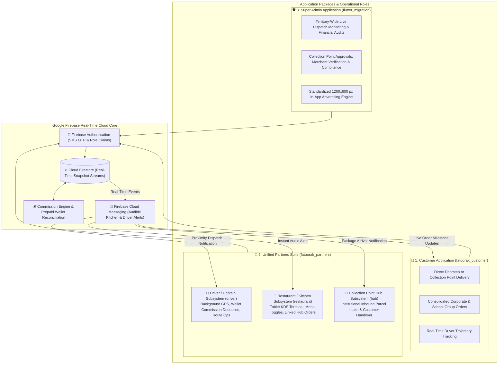

# 🍳 Fatoorak: 3-Package Multi-Role Breakfast & Food Logistics Ecosystem
### Enterprise Architecture & Technical Documentation for Customer, Admin & 3-in-1 Partners Suite

🌐 **Language / اللغة**: **English** | [العربية](README.md)

[](https://flutter.dev)
[](https://dart.dev)
[](https://firebase.google.com)
[-FFA611?logo=firebase&logoColor=white)](https://firebase.google.com/docs/firestore)
[](https://firebase.google.com/docs/cloud-messaging)
[](https://firebase.google.com/docs/firestore/security/get-started)
[](#-proprietary-rights--privacy-disclaimer)

---

## 📌 Executive Overview & Architectural Philosophy

**Fatoorak** is an integrated, hyper-local on-demand food logistics ecosystem designed to digitize and optimize the fresh morning breakfast sector. It connects traditional diners, commercial kitchens, and licensed home food producers with consumers and institutional clusters (schools, universities, enterprise corporate campuses) through an intelligent local distribution fleet.

The platform eliminates conventional delivery distance limitations by introducing **"Collection Points (نقاط التجميع)"** and **"Linked Order Routing (طلبات الربط)"**. Rather than relying on web frontends, the system operates purely through **three core Flutter application packages (covering 5 integrated operational roles)** synchronized in real time via **Google Firebase Cloud Firestore Real-Time Snapshot Streams**:

1. **📱 Customer App (`fatoorak_customer`)**: For individual ordering, collection point deliveries, and institutional group orders.
2. **🛡️ Central Super Admin App (`flutter_migration`)**: For territory-wide dispatch monitoring, collection point approvals, and commission audits.
3. **🤝 Unified Partners Suite (`fatoorak_partners`)**: A multi-role 3-in-1 application encapsulating:
   - 🛵 **Driver / Captain Subsystem (`driver`)**: Background GPS telemetry, prepaid wallet commission deductions, and turn-by-turn navigation.
   - 🍳 **Restaurant / Kitchen Subsystem (`restaurant`)**: Tablet Kitchen Display System (KDS), menu availability toggles, and remote linked hub orders.
   - 🏢 **Collection Point Hub Subsystem (`hub`)**: Institutional parcel reception, customer verification, and revolving cash custody.

> 🔒 **Proprietary Notice & Intellectual Property Disclaimer**:
> In accordance with commercial confidentiality and intellectual property safeguards, this repository is dedicated solely to documenting the **enterprise system architecture, real codebase file mapping, logistics state machines, and financial cash-flow mechanics** without exposing proprietary executable code or sensitive cloud secrets.

---

## 🏛️ End-to-End System Architecture



---

## 🧩 In-Depth Codebase & Screen Mapping for All Subsystems

### 1. 📱 Customer Application (Customer App)
* **Codebase Directory**:
  `Antigravity/fatoorak-breakfast-delivery/fatoorak_customer`
* **Key Production Screens & Components (`lib/customer/screens`)**:
  - **`home_screen.dart`**: Browse nearby traditional diners, home kitchens, morning breakfast categories, and active promotions.
  - **`customer_map_picker_screen.dart`**: Interactive GPS pin drop allowing selection between direct doorstep delivery or pickup from an authorized collection point.
  - **`shop_menu_screen.dart`**: Dynamic restaurant catalog with item customization, modifiers, and portion options.
  - **`cart_screen.dart` & `checkout_screen.dart`**: Shopping cart review, invoice summary, and cash-on-delivery (COD) confirmation.
  - **`order_tracking_screen.dart`**: Sub-second driver location tracking on interactive maps via live Firestore streams.
  - **`shared_orders_screen.dart`**: **"Consolidated Institutional Delivery"** batching employee and teacher orders into a unified delivery run to eliminate individual delivery fees.
  - **`vouchers_screen.dart`**: Voucher discount codes and promotional wallet credits.
  - **`orders_screen.dart` & `order_details_screen.dart`**: Historical order archive and itemized receipts.

---

### 2. 🛡️ Central Super Admin Application (Admin App)
* **Codebase Directory**:
  `Antigravity/fatoorak-breakfast-delivery/flutter_migration` (inside `lib/admin`)
* **Key Production Screens & Components (`lib/admin/screens`)**:
  - **`admin_monitoring_screen.dart`**: Mission-control live dashboard tracking all regional active orders and intervening in logistical delays.
  - **`admin_collection_points_screen.dart` & `add_collection_point_screen.dart`**: Register, verify, and geofence new institutional collection points.
  - **`admin_shops_screen.dart`**: Restaurant management, price-matching parity audits, and account activation/suspension.
  - **`admin_drivers_screen.dart`**: Courier compliance, vehicle readiness, and active status telemetry.
  - **`admin_finance_screen.dart`**: Central financial clearing, platform commission auditing, and courier wallet top-up validation.
  - **`admin_ads_screen.dart`**: Enforces precise promotional asset standards at **1200×600 px** ($2:1$ aspect ratio) for $3	imes$ pixel-density screens.
  - **`admin_system_controls_screen.dart`**: Emergency system controls and cloud maintenance mode toggles.
  - **`admin_requests_screen.dart`**: Review onboarding applications and information updates submitted by partners.

---

### 3. 🤝 Unified Partners Suite (Multi-Role Platform)
* **Codebase Directory**:
  `Antigravity/fatoorak-breakfast-delivery/fatoorak_partners`
* **Architectural Modularity**: Single maintainable codebase hosting three distinct role-based modules dispatched at authentication:

#### A. 🛵 Driver & Courier Subsystem (`lib/driver`)
* **Screens & Modules (`lib/driver/screens`)**:
  - **`active_route_screen.dart`**: Navigation console directing the courier to the kitchen for pickup and onward to the customer or collection point.
  - **`available_orders_tab.dart`**: Proximity-based order pool displaying nearby pickup tasks ready for claim.
  - **`financials_tab.dart`**: In-app prepaid wallet, live commission deduction log, and daily take-home earnings ledger.
  - **`my_jobs_tab.dart` & `history_tab.dart`**: Active route tasks and completed delivery trip history.
  - **Background Location Engine**: Streams driver coordinates strictly when marked "Active", disconnecting when offline.

#### B. 🍳 Restaurant & Kitchen Subsystem (`lib/restaurant`)
* **Screens & Modules (`lib/restaurant/screens`)**:
  - **`kitchen_screen.dart`**: Tablet-optimized Kitchen Display System (KDS) featuring persistent audio chimes until an operator accepts and starts prep.
  - **`menu_screen.dart`**: Real-time menu management, pricing adjustments, and immediate item out-of-stock toggles.
  - **`linked_hubs_screen.dart` & `hub_requests_screen.dart`**: **"Linked Orders Feature"** enabling kitchens to partner with remote collection points to sell outside their local radius.
  - **`direct_orders_screen.dart` & `scheduled_orders_screen.dart`**: Live order queue separated into immediate and pre-scheduled morning deliveries.

#### C. 🏢 Institutional Collection Point Subsystem (`lib/hub`)
* **Screens & Modules (`lib/hub/screens`)**:
  - **`collection_point_dashboard_screen.dart`**: Institutional terminal for school/office coordinators to verify inbound courier parcels and dispatch to students/employees.
  - **`link_restaurant_screen.dart`**: Issue partnership requests to approved kitchens to supply breakfast packages to the hub.
  - **`linked_restaurants_screen.dart`**: Manage contracted partner kitchens and inspect their authorized morning menus.
  - **Revolving Cash Custody Settlement**: Reimburses the courier for the order cost upon parcel drop-off, recovering the exact sum in cash when the customer claims the package.

---

## 🔄 End-to-End Order & Cash-Flow Lifecycle

```plaintext
[1. Customer orders via fatoorak_customer -> Selects Collection Point or Doorstep]
                                      │
                                      ▼ (Immediate audio chime via FCM)
[2. Kitchen receives order on tablet KDS via fatoorak_partners & initiates prep]
                                      │
                                      ▼ (Dispatches nearest active courier with positive wallet)
[3. Courier arrives at kitchen -> Pays food cost in cash -> Receives hot package]
                                      │
                 ┌────────────────────┴────────────────────┐
                 ▼                                         ▼
    [Route A: Direct Doorstep]               [Route B: Institutional Collection Point]
                 │                                         │
                 │                                         ├─ Courier delivers parcel & collects cash from agent
                 │                                         ├─ Agent marks status: "Package Received"
                 │                                         └─ Customer arrives, pays cash to agent & collects meal
                 │
                 ▼
[4. Transaction completed -> Cloud engine automatically debits platform fee from courier wallet]
```

---

## 📂 Real Source Code Directory Tree

```plaintext
Fatoorak/
└── Antigravity/fatoorak-breakfast-delivery/
    │
    ├── 📱 fatoorak_customer/             # Customer Mobile Application (Flutter)
    │   └── lib/customer/
    │       ├── screens/                  # (home, menu, cart, checkout, map_picker, tracking, shared)
    │       ├── providers/                # State management (Cart, Auth, Location)
    │       └── services/                 # Firebase listeners & Order services
    │
    ├── 🛡️ flutter_migration/             # Super Admin Application (Flutter)
    │   └── lib/admin/
    │       ├── screens/                  # (monitoring, collection_points, shops, drivers, finance, ads)
    │       └── services/                 # Admin APIs, Audit logs & Cloud controls
    │
    └── 🤝 fatoorak_partners/             # Unified 3-in-1 Partners Application (Flutter)
        └── lib/
            ├── driver/                   # 🛵 Driver / Courier Subsystem
            │   └── screens/              # (active_route, available_orders, financials, my_jobs)
            ├── restaurant/               # 🍳 Restaurant / Kitchen KDS Subsystem
            │   └── screens/              # (kitchen_kds, menu, linked_hubs, direct_orders)
            └── hub/                      # 🏢 Institutional Collection Point Subsystem
                └── screens/              # (collection_point_dashboard, link_restaurants)
```

---

## 🔒 Proprietary Rights & Privacy Disclaimer
* All intellectual property, conceptual system designs, operational logistics workflows, and trademarks are the exclusive property of **Fatoorak (فطورك)** © 2026.
* This repository is published strictly for technical evaluation, system design showcases, and multi-tenant supply-chain architecture review.
