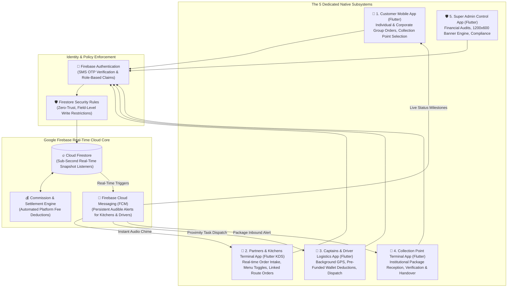

# 🍳 Fatoorak: 5-Application Smart Food Logistics & Multi-Tenant Breakfast Ecosystem
### Enterprise System Architecture, Multi-Client Cloud Infrastructure & Hyper-Local Supply Chain Design

🌐 **Language / اللغة**: **English** | [العربية](README.md)

[](https://flutter.dev)
[](https://dart.dev)
[](https://firebase.google.com)
[-FFA611?logo=firebase&logoColor=white)](https://firebase.google.com/docs/firestore)
[](https://firebase.google.com/docs/cloud-messaging)
[](https://firebase.google.com/docs/firestore/security/get-started)
[](#-proprietary-rights--privacy-disclaimer)

---

## 📌 Executive Overview & Operating Philosophy

**Fatoorak** is an integrated, hyper-local on-demand food logistics ecosystem designed to digitize and optimize the fresh morning breakfast sector. It bridges traditional eateries, commercial kitchens, and home-based culinary producers with end-consumers and corporate workforces (schools, universities, enterprise campuses) through an intelligent local distribution fleet.

The ecosystem breaks conventional delivery distance constraints by introducing **"Collection Points (نقاط التجميع)"** and **"Linked Order Routing (طلبات الربط)"**. Rather than relying on consumer web frontends, the platform operates purely through **five dedicated native mobile applications (5 Integrated Subsystems)** synchronized in real time via **Google Firebase Cloud Firestore Real-Time Snapshot Streams**.

> 🔒 **Proprietary Notice & Intellectual Property Disclaimer**:
> In accordance with commercial confidentiality and intellectual property safeguards, this repository is dedicated solely to documenting the **enterprise system architecture, logistics state machines, financial cash-flow mechanics, and 5-app structural modularity** without exposing proprietary executable code or sensitive cloud secrets.

---

## 🏛️ End-to-End System Architecture

The diagram below illustrates the real-time operational mesh connecting all five dedicated applications with the cloud core:



---

## 🧩 Detailed Breakdown of the 5 Dedicated Applications

### 1. 📱 Customer Mobile App (Flutter / Dart)
* **Target Audience**: Retail consumers, school faculty, corporate employee clusters, and students.
* **Architectural Capabilities**:
  - **Dual Fulfillment Options**: Direct doorstep delivery or pickup from a verified institutional **"Collection Point"** (school, corporate campus, commercial complex).
  - **"Consolidated Institutional Delivery (التوصيل على الكل)"**: Merges breakfast orders from coworkers into a synchronized batch dispatch, drastically reducing delivery fees and packaging arrivals into a single punctual drop-off.
  - **"Distance-Breaking Linked Catalog"**: Enables ordering from distant kitchens outside the standard radius by routing through verified partner collection points.
  - **Live GPS Tracking**: Real-time driver trajectory tracking with battery-optimized background updates.

---

### 2. 🍳 Partners & Kitchens Terminal App (Flutter / Dart)
* **Target Audience**: Traditional diners, commercial kitchens, and licensed home food producers.
* **Architectural Capabilities**:
  - **Digital Kitchen Display System (KDS)**: High-visibility order queue featuring continuous audible alerts that persist until an operator physically confirms preparation.
  - **"Linked Orders Feature (طلبات الربط)"**: Allows kitchens to contractually link with remote collection points (e.g., distant schools), opening entirely new market territories beyond their immediate neighborhood.
  - **Instant Stock Gating**: Toggle item availability with a single tap to prevent kitchen overflow or stockout cancellations.
  - **Merchant Ledger**: Real-time tracking of gross sales, net earnings, and platform technology fee deductions.

---

### 3. 🛵 Captains & Driver Logistics App (Flutter / Dart)
* **Target Audience**: Independent logistics partners and delivery couriers.
* **Architectural Capabilities**:
  - **Background GPS Telemetry**: Broadcasts live coordinates strictly while the driver is toggled "Active", enabling proximity-based task dispatch and client tracking.
  - **Pre-Funded Digital Wallet Architecture**: Couriers maintain a required minimum balance in their in-app wallet; upon completing cash collections, the platform automatically debits its commission fee directly from the prepaid wallet.
  - **Dual-Phase Physical Cash Flow**:
    1. Driver pays the restaurant the wholesale food cost in cash upon pickup (secured temporary outlay).
    2. Driver collects the full order sum (food cost + delivery fee) in cash from the consumer or the Collection Point agent upon delivery.

---

### 4. 🏢 Collection Point Terminal App (Flutter / Dart)
* **Target Audience**: Schools, business towers, government institutions, and partner commercial hubs.
* **Architectural Capabilities**:
  - **Smart Institutional Inbound Hub**: Streamlines high-volume breakfast deliveries for large groups without lobby congestion.
  - **Package Verification & Handover**: Reconciles courier package IDs upon arrival, notifying the end-recipient, and validating customer identity prior to handover.
  - **Revolving Cash Custody Settlement**:
    1. Collection point agent settles the order cost in cash with the courier upon parcel arrival.
    2. Collection point collects the exact invoice amount in cash from the customer upon pickup.
    3. Generates supplementary operational revenue or serves as an organized community amenity.

---

### 5. 🛡️ Super Admin Control App (Flutter / Dart)
* **Target Audience**: Central platform operations, logistics dispatchers, and finance controllers.
* **Architectural Capabilities**:
  - **Master Audit Ledger**: Authoritative historical audit trail for resolving financial or logistical discrepancies across all four stakeholder groups.
  - **Standardized In-App Banner Engine**: Enforces strict programmatic advertising assets at exactly **1200×600 px** ($2:1$ aspect ratio) to guarantee pixel clarity across $3\times$ high-density mobile displays.
  - **Geo-Boundary & Compliance Governance**: Approves new collection points, monitors hygiene ratings, enforces price-matching parity, and penalizes non-compliant drivers.

---

## 🔄 Integrated Order & Cash-Flow Lifecycle

```plaintext
[1. Consumer places order -> Selects Collection Point or Direct Doorstep]
                       │
                       ▼ (Continuous audio alert via FCM)
[2. Kitchen accepts order & initiates food prep]
                       │
                       ▼ (Dispatches nearest active courier with sufficient wallet balance)
[3. Courier arrives at kitchen -> Pays food cost in cash -> Receives hot order]
                       │
         ┌─────────────┴─────────────┐
         ▼                           ▼
[Route A: Direct Doorstep]      [Route B: Institutional Collection Point]
         │                           │
         │                           ├─ Courier hands parcel to agent & collects cash
         │                           ├─ Agent updates status: "Package Received"
         │                           └─ End customer arrives, pays agent & collects food
         │
         ▼
[4. Final cash collection -> Cloud engine automatically debits platform fee from courier wallet]
```

---

## 🛠️ Technology Stack Breakdown

| Subsystem / Layer | Technologies | Architectural Scope |
| :--- | :--- | :--- |
| **Customer App** | `Flutter 3.x`, `Dart` | Reactive catalog, live tracking, consolidated corporate orders. |
| **Kitchen App** | `Flutter (Tablet/Phone)` | Continuous audio KDS engine, menu availability, remote linked orders. |
| **Courier App** | `Flutter`, `Background GPS` | Background location streaming, prepaid wallet deduction, route navigation. |
| **Collection Point App** | `Flutter` | Institutional parcel verification, status milestones, and cash custody. |
| **Admin App** | `Flutter / Dart` | Central operations, master audit logs, 1200x600 banner engine, compliance. |
| **Database & Streaming** | `Cloud Firestore` | Zero-latency real-time snapshot listeners syncing all 5 client states. |
| **Push Notifications** | `Firebase Cloud Messaging` | Reliable high-priority audible alerts waking up kitchen and courier terminals. |
| **Security Governance** | `Firestore Security Rules` | Multi-tenant data isolation, price tampering prevention, role-based access. |

---

## 📂 Modular System Folder Tree

```plaintext
fatoorak-system/
├── apps/
│   ├── fatoorak_customer/          # 📱 Customer App (Direct, Collection Points, Live GPS)
│   │   ├── lib/features/           # (catalog, group_orders, collection_points, tracking)
│   │   └── lib/core/               # State management, Theme & Network
│   │
│   ├── fatoorak_partners/          # 🍳 Kitchen KDS Terminal (Audio alerts, Linked orders)
│   │   ├── lib/features/           # (live_orders, link_requests, menu_stock, earnings)
│   │   └── lib/core/               # Continuous sound engine & Realtime listeners
│   │
│   ├── fatoorak_captains/          # 🛵 Courier App (Background GPS, Wallet commissions)
│   │   ├── lib/features/           # (dispatch, background_location, cash_settlement)
│   │   └── lib/core/               # Wallet validator & Route navigation
│   │
│   ├── fatoorak_collection_points/ # 🏢 Collection Point App (Institutional parcel handover)
│   │   ├── lib/features/           # (package_intake, client_handover, point_finance)
│   │   └── lib/core/               # Package barcode/ID verifier
│   │
│   └── fatoorak_admin/             # 🛡️ Super Admin App (Audit logs, 1200x600 banner manager)
│       ├── lib/features/           # (audit_logs, banners_1200x600, partner_compliance)
│       └── lib/core/               # Master administrative controls
│
├── cloud_services/
│   ├── firestore.rules             # 🛡️ Data isolation & financial validation rules
│   └── storage.rules               # 📦 Image asset validation & banner upload constraints
│
└── .gitignore                      # Comprehensive exclusions for secret tokens and keys
```

---

## 🔒 Proprietary Rights & Privacy Disclaimer
* All intellectual property, conceptual system designs, operational logistics workflows, and trademarks are the exclusive property of **Fatoorak (فطورك)** © 2026.
* This repository is published strictly for technical evaluation, system design showcases, and multi-tenant supply-chain architecture review.
